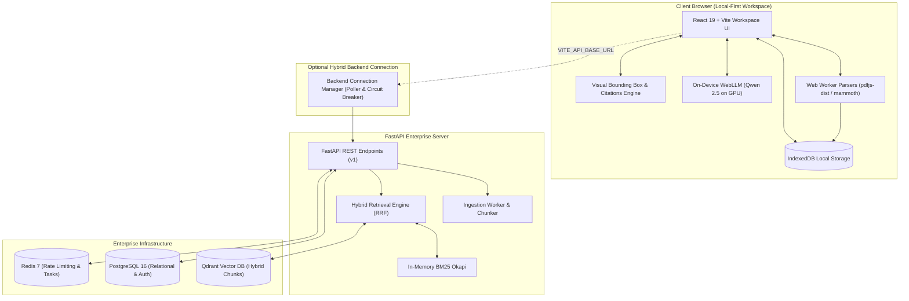

# DocuMind AI

<p align="center">
  <strong>Private, Verifiable Document Intelligence & Grounded Research Assistant</strong>
</p>

<p align="center">
  <a href="#key-features">Features</a> •
  <a href="#architecture">Architecture</a> •
  <a href="#quick-start">Quick Start</a> •
  <a href="#tech-stack">Tech Stack</a> •
  <a href="#api-reference">API Reference</a> •
  <a href="#verification--testing">Testing</a> •
  <a href="#license">License</a>
</p>

<p align="center">
  
  
  
  
  
  
  
  
</p>

---

## Overview

**DocuMind AI** is a dual-mode, privacy-first document intelligence platform built for researchers, analysts, and students. It eliminates synthetic hallucinations by enforcing strict, mathematical **PaperQA source grounding**: every statement synthesized by the system is anchored to exact passage locators (page numbers, section headings, and visual bounding boxes).

The platform can operate **100% locally on-device** (via WebGPU, WebLLM, and client-side IndexedDB with zero cloud transmission) or connect to an **enterprise-grade hybrid retrieval backend** powered by FastAPI, PostgreSQL, and Qdrant.

---

## Key Features

### 1. Dual-Mode Grounded AI Assistant
- **On-Device Neural Model**: Runs quantized local LLMs (`Qwen2.5-0.5B-Instruct` via WebGPU and WebLLM) directly inside the user's browser. Model weights (~350 MB) download once into the browser Cache API for instant, private offline inference.
- **Deterministic Evidence Fallback**: When WebGPU is unavailable or deferred, DocuMind falls back to instant keyword excerpt retrieval and verified citation synthesis with zero model weight downloads.
- **Hallucination Prevention**: Zero synthetic claims. Answers are drawn strictly from retrieved document chunks or explicitly report no matching evidence.

### 2. High-Performance Hybrid Retrieval & Neural Re-Ranking
- **BM25 Okapi + Dense Vector Search**: Integrates Lexical BM25 ranking with Qdrant vector embeddings via **Reciprocal Rank Fusion (RRF)**.
- **Cross-Encoder Neural Re-Ranking**: Second-stage cross-encoder re-ranking scores candidate chunks with deep semantic relevance and provides confidence percentiles.
- **Multi-Tenant Isolation**: Rigorous tenant and document isolation (`owner_id` + `document_ids` filters) prevents cross-tenant citation forgery or IDOR leaks.
- **Resilient Cold-Start Handling**: Built-in non-blocking reconnect backoffs absorb container lag and maintain high availability.

### 3. Visual Document Grounding & Page-by-Page Inspection
- **Interactive Page-by-Page Viewer**: Inspect PDF, DOCX, and TXT files with thumbnail sidebars, zoom controls (50% to 200%), and page navigation.
- **Visual Bounding Box Citations**: Every cited passage is anchored to proportional visual bounding box coordinates on the preview canvas.
- **Split-Pane Document Reader**: Full-featured drawer with section jumper navigation, text filtering, and one-click jump-to-source.

### 4. Multimodal VLM Chart & Image Reasoning
- **Visual Figure & Chart Detection**: Automatic detection of charts, plots, and architecture diagrams within document pages.
- **VLM Reasoning Prompts**: Vision-Language prompt templates for automated metric extraction, trend summarization, and data verification from images.

### 5. Automated Structured Schema Extraction
- **Context-Aware Schema Inference**: Automatically selects optimal extraction schemas based on document type (Research Paper, Market Analysis, Legal Agreement, and Brand & Product Guidelines).
- **Tabular Matrix & JSON Export**: View extracted fields in structured tables with cited evidence passages or export as validated JSON.

### 6. Cross-Document Comparative Matrix
- **Side-by-Side Analysis**: Compare multiple documents simultaneously across analytical dimensions (e.g., Governance, Performance, Security, Cost).
- **Custom Topic Querying**: Enter targeted queries to extract comparative evidence across all staged files.

### 7. Local-First Privacy & Persistent Chat History
- **100% Client-Side Extraction**: Client-side parsing via `pdfjs-dist` (PDF), `mammoth` (DOCX), and native text decoders.
- **IndexedDB Session Persistence**: AI chat conversations, parsed document chunks, and user preferences persist securely in IndexedDB across reloads with automatic session hydration.
- **Token Observability & Governance**: Real-time token usage telemetry, operational budget limits, and hardware diagnostics.

### 8. Tactile Neo-Brutalist Design System ("The Paper Workbench")
- **Distinctive Editorial Aesthetic**: Space Grotesk + DM Sans typography, tactile pastel palette (Mint, Sky, Butter), and solid black strokes.
- **Ergonomic Precision**: Tabular numerals (`tabular-nums`) to eliminate update jitter, proportional mechanical button physics, and comprehensive high-contrast Light and Dark themes.

---

## Architecture



---

## Tech Stack

| Layer | Technologies |
| :--- | :--- |
| **Frontend Framework** | [React 19](https://react.dev/), [Vite 6](https://vitejs.dev/), [React Router 7](https://reactrouter.com/) |
| **Styling & Motion** | [Tailwind CSS v4](https://tailwindcss.com/), [GSAP 3](https://gsap.com/) (ScrollSmoother, ScrollTrigger), Lucide Icons |
| **On-Device AI & Parsers** | [WebLLM](https://webllm.mlc.ai/) (WebGPU), [pdfjs-dist](https://github.com/mozilla/pdf.js), [mammoth.js](https://github.com/mwilliamson/mammoth.js) |
| **Backend Framework** | [FastAPI](https://fastapi.tiangolo.com/) (Python 3.11+), [Uvicorn](https://www.uvicorn.org/), Pydantic v2 |
| **Databases & Vector Store** | [PostgreSQL 16](https://www.postgresql.org/) (Async SQLAlchemy), [Qdrant](https://qdrant.tech/) Vector DB, [Redis 7](https://redis.io/) |
| **Database Migrations** | [Alembic](https://alembic.sqlalchemy.org/) |
| **Containerization** | Docker, Docker Compose |

---

## Quick Start

### Option 1: Run Frontend in Local-First Mode (Zero Cloud)

The frontend runs completely standalone with full on-device WebGPU and IndexedDB capabilities:

```bash
# 1. Clone repository
git clone https://github.com/your-username/Documind-ai.git
cd Documind-ai/Documind-ai

# 2. Install dependencies
npm install

# 3. Start development server
npm run dev
```

Open [http://localhost:5173](http://localhost:5173) in your browser.

---

### Option 2: Run Full Stack with Docker Compose

Run the complete platform (PostgreSQL, Redis, Qdrant, and FastAPI Backend):

```bash
# From the repository root:
docker compose up -d
```

Services started:
- **FastAPI Backend**: [http://localhost:8000](http://localhost:8000)
- **Interactive Swagger Docs**: [http://localhost:8000/api/v1/docs](http://localhost:8000/api/v1/docs)
- **Qdrant Vector DB UI**: [http://localhost:6333/dashboard](http://localhost:6333/dashboard)
- **PostgreSQL**: `localhost:5432` (db: `documind_db`)
- **Redis**: `localhost:6379`

Now launch the frontend to connect:
```bash
cd Documind-ai
npm run dev
```

---

### Option 3: Manual Backend Setup

If developing on the FastAPI backend directly:

```bash
# 1. Start required infrastructure containers
docker compose up -d postgres redis qdrant

# 2. Navigate to backend directory
cd backend

# 3. Create virtual environment
python -m venv .venv
source .venv/bin/activate  # On Windows: .venv\Scripts\Activate.ps1

# 4. Install dependencies
pip install -r requirements.txt

# 5. Run database migrations
alembic upgrade head

# 6. Start FastAPI server
uvicorn app.main:app --reload --port 8000
```

---

## API Reference

The backend provides a RESTful API compliant with OpenAPI v3 standards:

| Method | Endpoint | Description |
| :--- | :--- | :--- |
| `GET` | `/api/v1/health` | Healthcheck and container dependency status |
| `POST` | `/api/v1/documents` | Upload a document (PDF, DOCX, TXT) for ingestion |
| `GET` | `/api/v1/documents` | List stored documents for authenticated tenant |
| `GET` | `/api/v1/documents/{id}` | Retrieve document metadata and processing status |
| `DELETE` | `/api/v1/documents/{id}` | Soft-delete document and purge stored bytes |
| `GET` | `/api/v1/documents/{id}/content` | Retrieve extracted document chunks and locators |
| `POST` | `/api/v1/chat` | PaperQA-grounded retrieval & Q&A with citations |
| `GET` | `/api/v1/chat/conversations` | List conversation threads |
| `GET` | `/api/v1/chat/conversations/{id}` | Retrieve conversation message history |
| `GET` | `/api/v1/citations/{citation_id}` | Resolve citation to exact source chunk & page |

Interactive documentation is available at `/api/v1/docs` when the backend is running.

---

## Verification & Testing

DocuMind AI enforces a rigorous automated test suite covering security defenses, adversarial prompt injection neutralization, citation integrity, bounding box normalization, VLM chart reasoning, cross-encoder re-ranking, and cross-document comparison:

```bash
cd Documind-ai

# Run all unit and integration tests (122 tests across 21 suites)
npm test

# Run ESLint check (0 errors, 0 warnings enforced)
npm run lint

# Build production bundle
npm run build
```

---

## Repository Structure

```text
Documind-ai/
├── .github/                   # CI/CD workflows and issue templates
├── backend/                   # FastAPI Backend
│   ├── app/
│   │   ├── api/v1/            # API endpoints (chat, documents, citations)
│   │   ├── core/              # Config, security, database sessions
│   │   ├── models/            # SQLAlchemy database models
│   │   ├── schemas/           # Pydantic validation schemas
│   │   └── services/          # Retrieval (BM25 + Qdrant), Ingestion, Agent
│   ├── migrations/            # Alembic database migrations
│   ├── tests/                 # Pytest backend test suite
│   ├── Dockerfile             # Backend container image
│   └── requirements.txt       # Python dependencies
├── Documind-ai/               # React 19 Frontend
│   ├── src/
│   │   ├── features/documents/# Core services (WebLLM, VLM reasoning, re-ranking, IndexedDB, etc.)
│   │   ├── LandingPage.jsx    # Neobrutalist landing page
│   │   ├── Workspace.jsx      # Research workspace & assistant interface
│   │   ├── styles.css         # The Paper Workbench design system styles
│   │   └── landing.css        # Landing page styling & animations
│   ├── tests/                 # Frontend node:test suite (122 tests across 21 suites)
│   └── package.json           # Frontend dependencies & scripts
├── docker-compose.yml         # Multi-container orchestration (PostgreSQL, Redis, Qdrant, Backend)
└── README.md                  # Project documentation
```

---

## Contributing

Contributions are welcome! Please follow these steps:

1. Fork the repository.
2. Create a feature branch: `git checkout -b feature/my-new-feature`.
3. Commit your changes: `git commit -am 'Add some feature'`.
4. Ensure tests and lint pass: `npm test && npm run lint`.
5. Push to the branch: `git push origin feature/my-new-feature`.
6. Open a Pull Request.

---

## License

This project is licensed under the [MIT License](LICENSE).
