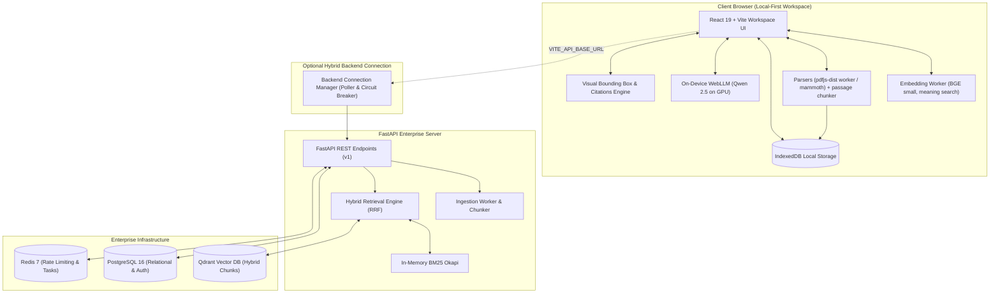

# DocuMind AI

<p align="center">
  <strong>Private, Verifiable Document Intelligence & Grounded Research Assistant</strong>
</p>

<p align="center">
  <a href="#key-features">Features</a> •
  <a href="#architecture">Architecture</a> •
  <a href="#quick-start">Quick Start</a> •
  <a href="#tech-stack">Tech Stack</a> •
  <a href="#api-reference">API Reference</a> •
  <a href="#verification--testing">Testing</a> •
  <a href="#license">License</a>
</p>

<p align="center">
  
  
  
  
  
  
  
  
  
  
  
  
  
</p>

---

## Overview

**DocuMind AI** is a dual-mode, privacy-first document intelligence platform built for researchers, analysts, and students. It eliminates synthetic hallucinations by enforcing strict, mathematical **PaperQA source grounding**: every statement synthesized by the system is anchored to exact passage locators (page numbers, section headings, and visual bounding boxes).

The platform can operate **100% locally on-device** (via WebGPU, WebLLM, and client-side IndexedDB with zero cloud transmission) or connect to an **enterprise-grade hybrid retrieval backend** powered by FastAPI, PostgreSQL, and Qdrant.

---

## Key Features

### 1. Dual-Mode Grounded AI Assistant
- **On-Device Model, Your Choice**: Runs a quantized LLM through WebLLM on WebGPU inside the browser. Qwen 2.5 1.5B (~1 GB) is the default; Qwen 2.5 3B (~1.8 GB) gives the best answers, and Qwen 2.5 0.5B and SmolLM2 360M are lighter options. The 16-bit build is used automatically on GPUs that support it. Weights download once into the browser cache.
- **Streamed, Checked Answers**: Answers appear as they are generated. Every `[n]` citation is checked against the passages actually given to the model; citations to passages that do not exist are removed, and an answer with no valid citation is flagged.
- **Passages-Only Mode**: Without a model (no WebGPU, or not set up), DocuMind answers with the matching passages themselves, each with its source, and no model download.
- **Question First**: The Evidence Assistant opens on the question box. One short strip states how answers are produced (*passages only* or *written by a model on your GPU*) and how passages are found (*keywords* or *keywords and meaning*); the model picker opens from it only when asked. An empty result explains why and offers meaning search.
- **Asks Before Anything Leaves**: Searches and the on-device model run without interruption. Only when a DocuMind server is connected does a question wait for an inline confirmation, with the option to answer in the browser instead.
- **Copy With Sources**: Copying a written answer includes every cited passage with its document and page, so the `[n]` markers still point somewhere once pasted.
- **Hallucination Prevention**: Zero synthetic claims. Answers are drawn strictly from retrieved document chunks or explicitly report no matching evidence.

### 2. High-Performance Hybrid Retrieval & Neural Re-Ranking
- **BM25 Okapi + Dense Vector Search**: Integrates Lexical BM25 ranking with Qdrant vector embeddings via **Reciprocal Rank Fusion (RRF)**.
- **In-Browser Meaning Search**: An optional ~34 MB sentence-embedding model (BGE small via transformers.js, in a Web Worker) embeds every passage on the device. Questions are matched by keyword and by meaning, and the two rankings are merged with Reciprocal Rank Fusion, so "how fast is the sector growing?" finds "24% year-over-year expansion". Vectors are stored with the document in IndexedDB.
- **Keyword Re-Ranking**: Keyword results are re-ranked by term coverage and how close the terms sit together (a heuristic, not a neural model). On the backend, a BGE cross-encoder is used when `sentence-transformers` is installed.
- **Multi-Tenant Isolation**: Rigorous tenant and document isolation (`owner_id` + `document_ids` filters) prevents cross-tenant citation forgery or IDOR leaks.
- **Resilient Cold-Start Handling**: Built-in non-blocking reconnect backoffs absorb container lag and maintain high availability.

### 3. Reading and Verifying Sources
- **Read**: The whole document as one flowing text with page markers. Opening a citation lands on the cited passage, framed in red and labelled with why it is marked (*Cited in the answer*, *Search match*, *Compared passage*, *Extracted from here*). Search words are underlined, and the document opens whole; *Show only those passages* filters to the passages containing every search word.
- **Page View**: For saved PDFs, the original page itself, drawn by PDF.js from the file kept in IndexedDB, with real page thumbnails and zoom. The cited passage is framed in red at the exact place its text sits on the page, and the text read from the page is listed below it. Sample documents and DOCX/TXT files show the extracted text instead, labelled as such.
- **Scanned PDFs (OCR)**: Pages with no text layer are detected on import instead of failing. *Read scanned pages* recognises their text in the browser with Tesseract (English); the engine and model (~7 MB) are served by this site, never a CDN, and download only on first use. Recognised passages are searchable, citable and framed on the page like any other, and are tagged *Read by OCR*.
- **Readable Passages**: Markdown headings and pipe tables inside documents are shown as headings and tables, and search snippets are cut on word boundaries.
- **Keyboard and Screen Readers**: Every dialog takes focus when it opens, keeps Tab inside, closes only the top layer on Esc, and returns focus to whatever opened it. Copying a citation and switching views use real, named buttons.
- **Phones**: Below 760px the reader is full screen and text first; on touch screens every control is at least 44px.

### 4. Figure & Table Values
- **Visual Figure & Chart Detection**: Automatic detection of charts, plots, and architecture diagrams within document pages.
- **Values From Text Only**: Labelled values in figure and table passages are extracted from the text and can be listed, ranked by stated change, or looked up by label. No image model is used, and nothing is stated that the extracted values do not contain.

### 5. Automated Structured Schema Extraction
- **Context-Aware Schema Inference**: Automatically selects optimal extraction schemas based on document type (Research Paper, Market Analysis, Legal Agreement, and Brand & Product Guidelines).
- **Tabular Matrix & JSON Export**: View extracted fields in structured tables with cited evidence passages or export as validated JSON.

### 6. Cross-Document Comparative Matrix
- **Side-by-Side Analysis**: Compare multiple documents simultaneously across analytical dimensions (e.g., Governance, Performance, Security, Cost).
- **Facts, Not Verdicts**: Each topic states which documents have a passage on it and the words those passages share; it never claims the documents agree. The passages sit side by side for the reader to judge, and the results scroll into view and take focus when ready.
- **Custom Topic Querying**: Enter targeted queries to extract comparative evidence across all staged files.

### 7. Local-First Privacy & Persistent Chat History
- **100% Client-Side Extraction**: Client-side parsing via `pdfjs-dist` (PDF), `mammoth` (DOCX), native text decoders, and `tesseract.js` for scanned pages. Original PDFs are kept in their own IndexedDB store so the library loads without reading every file.
- **IndexedDB Session Persistence**: AI chat conversations, parsed document chunks, and user preferences persist securely in IndexedDB across reloads with automatic session hydration.
- **Token Observability & Governance**: Real-time token usage telemetry, operational budget limits, and hardware diagnostics.

### 8. Cyber-Brutalist Design System ("The Instrument Sheet")
- **One System, Two Surfaces**: The front page (`/`) and the workspace (`/workspace`) share one look: a light grey ground, near-black ink, 1px frames and hairline grids, square corners, no drop shadows, and a single signal red reserved for primary actions, selection, focus and live states.
- **Three Faces, Fixed Jobs**: Anton for display headlines, Martian Mono for the interface, labels and data, and Source Serif 4 for long reading (documents, AI answers and quoted passages).
- **Real Readouts Only**: The front page checks the visitor's own browser live (WebGPU availability, free storage, whether the model is cached) instead of showing invented statistics.
- **Ergonomic Precision**: Tabular numerals (`tabular-nums`) to eliminate update jitter, and matching light and dark themes in the workspace.

---

## Architecture



---

## Tech Stack

DocuMind AI combines a local-first browser runtime with an enterprise hybrid retrieval architecture:

### 1. Frontend & Client-Side Core
- **Framework & Tooling**: [React 19](https://react.dev/), [Vite 6](https://vitejs.dev/) with native ES modules and fast HMR, [React Router 7](https://reactrouter.com/) for single-page routing.
- **State**: React state and custom hooks (`useDocumentImport`, `useSemanticIndex`, `useOverlay`); persistence in IndexedDB. Zustand, TanStack React Query and React Dropzone are listed in `package.json` but not used yet.
- **File Ingestion**: Native drag-and-drop and file input with type and size validation (`validate.js`), then a staging queue before files are saved.

### 2. Styling, Motion & Design System
- **Design Language**: Custom **"The Instrument Sheet"** cyber-brutalist design system: grey ground `#f1f1ef`, ink `#0b0b0b`, one signal red `#d3110f`, 1px structural frames and hairline grids, square corners and no box shadows. Tokens and rules live in [`Documind-ai/DESIGN.md`](Documind-ai/DESIGN.md).
- **Typography**: [Anton](https://fonts.google.com/specimen/Anton) (display), [Martian Mono](https://fonts.google.com/specimen/Martian+Mono) (interface) and [Source Serif 4](https://fonts.google.com/specimen/Source+Serif+4) (reading text), loaded from Google Fonts.
- **CSS Architecture**: [Tailwind CSS v4](https://tailwindcss.com/) with native modern CSS variables, `tabular-nums` alignment, and full Dark Mode (`.dark` / `color-scheme: dark`) synchronization across the entire viewport.
- **Animation & Motion**: [GSAP 3](https://gsap.com/) (`@gsap/react`), set up once in `src/gsap.js` with only the plugins in use (ScrambleText, ScrollTo).
  - *Front page*: the entrance sequence (headline rise, a scan line landing on the cited passage, ledger stamps pressing in); readouts that decode as the real browser checks return; and a grounding trace, where a red rule draws under the source passage and the `[1]` citation stamps onto the answer.
  - *Workspace*: the reader opening, the cited passage settling in when a citation opens it, new answers' passages arriving as a short list, and Compare scrolling to its results. Routine states use short CSS transitions.
  - With `prefers-reduced-motion`, nothing moves: values and states simply appear.
- **Iconography**: [Lucide React](https://lucide.dev/) stroke-based accessible iconography.

### 3. On-Device AI & Hardware Acceleration
- **In-Browser LLM Runtime**: [WebLLM](https://webllm.mlc.ai/) powered by **Apache TVM** and **WebGPU**, compiling optimized WGSL shaders directly onto client graphics hardware.
- **Quantized Weights**: Qwen 2.5 1.5B / 3B / 0.5B and SmolLM2 360M (`q4f16_1` or `q4f32_1` builds, chosen from the GPU's `shader-f16` support), downloaded once into the browser's `Cache API`.
- **Sentence Embeddings**: `Xenova/bge-small-en-v1.5` (8-bit, ~34 MB) through [transformers.js](https://huggingface.co/docs/transformers.js), run in a Web Worker.
- **Hardware Telemetry**: Navigator WebGPU adapter probing, VRAM limit checks, and live Token Governance budget tracking (`createTokenBudgetTracker`).

### 4. Client-Side Document Parsing & Local Storage
- **PDF Extraction**: [pdfjs-dist](https://github.com/mozilla/pdf.js) (Mozilla PDF.js) rebuilds each page's reading order (lines, paragraphs, rejoined hyphenation) from positioned text items. Highlight boxes come from the real positions of each passage's text on the page.
- **Passages**: Text is split into passages of about 900 characters at paragraph and sentence boundaries, starting a new passage at headings, so several passages fit in the model's 4K context.
- **DOCX Extraction**: [Mammoth.js](https://github.com/mwilliamson/mammoth.js) converting Word XML structures to sanitized semantic HTML chunks and paragraphs.
- **Local Persistence**: Browser [IndexedDB](https://developer.mozilla.org/en-US/docs/Web/API/IndexedDB_API) via [idb 8](https://github.com/jakearchibald/idb) across two isolated databases:
  - `documind_db`: Persists staged files, text chunks, and document metadata across reloads.
  - `documind_conversations`: Persists timestamped chat sessions with auto-generated titles, message logs, and citation records.

### 5. Algorithmic Intelligence & Grounding
- **Lexical Retrieval**: In-memory BM25 Okapi with custom tokenization, lowercasing, punctuation stripping, and stop-word filtering (`k1=1.5`, `b=0.75`). The same stop-word list is used by the backend embedding and the no-model reranker, which match whole words only.
- **Dense Vector Search**: Qdrant HNSW vector indexing with cosine distance metric. Backend vectors use a stable content hash (BLAKE2b), so they mean the same thing after every restart. Each stored point records its embedding version; search ignores other versions, and on startup the backend re-embeds any stale points from the text kept in their payload.
- **Reciprocal Rank Fusion (RRF)**: Merges sparse lexical rankings with dense vector embeddings using constant reciprocal scoring ($k=60$).
- **Hybrid Retrieval in the Browser**: Keyword scoring plus embedding similarity, fused with Reciprocal Rank Fusion; a passage found only by meaning must clear a similarity floor, so unrelated questions still get no evidence.
- **Visual Grounding Engine**: Proportional coordinate normalization algorithms mapping text chunk offsets to visual bounding boxes across page thumbnails and split-pane reader views.
- **Schema Extraction Engine**: Automated schema inference matching document titles and passages against structured schemas (Research Paper, Market Analysis, Legal Agreement, Product/Brand Guidelines).

### 6. Backend Server & API Layer
- **API Framework**: [FastAPI 0.111+](https://fastapi.tiangolo.com/) with asynchronous ASGI event loop powered by [Uvicorn](https://www.uvicorn.org/).
- **Data Validation & Settings**: [Pydantic v2](https://docs.pydantic.dev/) and `pydantic-settings` for type validation and environment loading.
- **Server-Side Document Parsers**: [PyMuPDF](https://pymupdf.readthedocs.io/) (`fitz`) for server PDF extraction and [python-docx](https://python-docx.readthedocs.io/) for Word files.
- **HTTP Client**: [HTTPX](https://www.python-httpx.org/) for async non-blocking external requests and health probing.
- **Security & Tokens**: [python-jose](https://github.com/mpdavis/python-jose) (JWT cryptographic verification) and [passlib](https://passlib.readthedocs.io/) (bcrypt password hashing).

### 7. Databases, ORM & Caching
- **Relational Database**: [PostgreSQL 16](https://www.postgresql.org/) for relational tenant storage, document records, and conversation history.
- **Asynchronous ORM**: [SQLAlchemy 2.0](https://www.sqlalchemy.org/) with async engine via [asyncpg](https://github.com/MagicStack/asyncpg).
- **Schema Migrations**: [Alembic](https://alembic.sqlalchemy.org/) for version-controlled, reproducible database schema migrations.
- **Vector Database**: [Qdrant v1.9](https://qdrant.tech/) for scalable vector embeddings, payload filtering, and tenant isolation.
- **In-Memory Cache & Broker**: [Redis 7](https://redis.io/) for session caching, rate limiting, and background task queues.

### 8. DevOps, Testing & Quality Assurance
- **Containerization**: [Docker](https://www.docker.com/) and [Docker Compose](https://docs.docker.com/compose/) defining multi-container orchestration across services.
- **Frontend Test Suite**: Native Node.js Test Runner (`node:test`, `node:assert/strict`) executing **146 automated unit and integration tests across 29 test suites** with zero third-party testing dependencies.
- **Backend Test Suite**: [pytest 8](https://docs.pytest.org/), `pytest-asyncio`, and `pytest-cov` for backend API and retrieval tests.
- **Code Quality**: [ESLint 9](https://eslint.org/) flat configuration enforcing clean code (0 errors, 0 warnings enforced).

---

## Quick Start

### Option 1: Run Frontend in Local-First Mode (Zero Cloud)

The frontend runs completely standalone with full on-device WebGPU and IndexedDB capabilities:

```bash
# 1. Clone repository
git clone https://github.com/baymax-14/Documind-ai.git
cd Documind-ai/Documind-ai

# 2. Install dependencies
npm install

# 3. Start development server
npm run dev
```

Open [http://localhost:5173](http://localhost:5173) in your browser.

---

### Option 2: Run Full Stack with Docker Compose

Run the complete platform (PostgreSQL, Redis, Qdrant, and FastAPI Backend):

```bash
# From the repository root:
docker compose up -d
```

Services started:
- **FastAPI Backend**: [http://localhost:8000](http://localhost:8000)
- **Interactive Swagger Docs**: [http://localhost:8000/api/v1/docs](http://localhost:8000/api/v1/docs)
- **Qdrant Vector DB UI**: [http://localhost:6333/dashboard](http://localhost:6333/dashboard)
- **PostgreSQL**: `localhost:5432` (db: `documind_db`)
- **Redis**: `localhost:6379`

Now launch the frontend to connect:
```bash
cd Documind-ai
npm run dev
```

---

### Option 3: Manual Backend Setup

If developing on the FastAPI backend directly:

```bash
# 1. Start required infrastructure containers
docker compose up -d postgres redis qdrant

# 2. Navigate to backend directory
cd backend

# 3. Create virtual environment
python -m venv .venv
source .venv/bin/activate  # On Windows: .venv\Scripts\Activate.ps1

# 4. Install dependencies
pip install -r requirements.txt

# 5. Run database migrations
alembic upgrade head

# 6. Start FastAPI server
uvicorn app.main:app --reload --port 8000
```

---

## API Reference

The backend provides a RESTful API compliant with OpenAPI v3 standards:

| Method | Endpoint | Description |
| :--- | :--- | :--- |
| `GET` | `/api/v1/health` | Healthcheck and container dependency status |
| `POST` | `/api/v1/documents` | Upload a document (PDF, DOCX, TXT) for ingestion |
| `GET` | `/api/v1/documents` | List stored documents for authenticated tenant |
| `GET` | `/api/v1/documents/{id}` | Retrieve document metadata and processing status |
| `DELETE` | `/api/v1/documents/{id}` | Soft-delete document and purge stored bytes |
| `GET` | `/api/v1/documents/{id}/content` | Retrieve extracted document chunks and locators |
| `POST` | `/api/v1/chat` | PaperQA-grounded retrieval & Q&A with citations |
| `GET` | `/api/v1/chat/conversations` | List conversation threads |
| `GET` | `/api/v1/chat/conversations/{id}` | Retrieve conversation message history |
| `GET` | `/api/v1/citations/{citation_id}` | Resolve citation to exact source chunk & page |

Interactive documentation is available at `/api/v1/docs` when the backend is running.

---

## Verification & Testing

DocuMind AI enforces a rigorous automated test suite covering security defenses, adversarial prompt injection neutralization, citation integrity, bounding box normalization, passage chunking, hybrid keyword + meaning retrieval, answer citation checks, figure value extraction, and cross-document comparison:

```bash
cd Documind-ai

# Run all unit and integration tests (146 tests across 29 suites)
npm test

# Run ESLint check (0 errors, 0 warnings enforced)
npm run lint

# Build production bundle
npm run build
```

---

## Repository Structure

```text
Documind-ai/
├── backend/                   # FastAPI Backend
│   ├── app/
│   │   ├── api/v1/            # API endpoints (chat, documents, citations)
│   │   ├── core/              # Config, security, database sessions
│   │   ├── models/            # SQLAlchemy database models
│   │   ├── schemas/           # Pydantic validation schemas
│   │   └── services/          # Retrieval (BM25 + Qdrant), Ingestion, Agent
│   ├── migrations/            # Alembic database migrations
│   ├── tests/                 # Pytest backend test suite
│   ├── Dockerfile             # Backend container image
│   └── requirements.txt       # Python dependencies
├── Documind-ai/               # React 19 Frontend
│   ├── src/
│   │   ├── features/documents/# Core services (WebLLM, embeddings, retrieval, IndexedDB, etc.)
│   │   ├── LandingPage.jsx    # Front page: live browser readouts, comparison ledger, demo
│   │   ├── Workspace.jsx      # Research workspace & assistant interface
│   │   ├── styles.css         # Workspace styles (Instrument Sheet, light and dark)
│   │   └── landing.css        # Front page styles (Instrument Sheet)
│   ├── tests/                 # Frontend node:test suite (146 tests across 29 suites)
│   └── package.json           # Frontend dependencies & scripts
├── docker-compose.yml         # Multi-container orchestration (PostgreSQL, Redis, Qdrant, Backend)
└── README.md                  # Project documentation
```

---

## Contributing

Contributions are welcome! Please follow these steps:

1. Fork the repository.
2. Create a feature branch: `git checkout -b feature/my-new-feature`.
3. Commit your changes: `git commit -am 'Add some feature'`.
4. Ensure tests and lint pass: `npm test && npm run lint`.
5. Push to the branch: `git push origin feature/my-new-feature`.
6. Open a Pull Request.

---

## License

This project is licensed under the [MIT License](LICENSE).
